# EmbodiedMind

*Memory, belief revision, and adaptive decision-making in partially observable embodied agents.*

EmbodiedMind studies how agents remember what they have seen, revise beliefs when new observations conflict with memory, and decide when to look again. It pairs policies on seeded MiniGrid and BabyAI missions, with controlled changes that hide observations or move a target out of sight. Model-backed experiments use a frozen Qwen 2.5 3B Instruct model served locally by Ollama on an NVIDIA GPU.

**Python 3.12** · **NVIDIA GPU** · **Local LLM inference** · **MiniGrid / BabyAI**

[Results](#results) · [Visualizations](docs/visualizations.md) · [Experiment viewer](#experiment-viewer) · [Quick start](#quick-start) · [Documentation](docs/README.md)

## Results

### Original B0–B3 study

The frozen study completed **240 static and 270 dynamic held-out episodes**, with 30 matched seeds per task or intervention. The original hypotheses concerned mission success, actions tied to contradicted evidence, the effects of information loss, and the cost of added memory structure.

| Registered comparison | Held-out result |
| --- | --- |
| DoorKey mission success, B3 vs. B1 | **8/30 vs. 4/30**, paired +13.3 percentage points (95% bootstrap interval [0, +30.0]). Reactive B0 solved **17/30**. |
| GoToObj Maze mission success, B3 vs. B1 | **5/30 each** with matching paired outcomes. |
| Hidden relocation, explicitly cited stale actions, B3 vs. B2 | **3 vs. 0** citations across 720 executed steps per arm. Revising memory did not reduce cited stale actions in this comparison. |

The stale-action measure captures explicit citations. The B3 vs. B2 contrast combines contradiction revision, aging and working memory. All 90 assigned relocations occurred. [Held-out report](reports/technical_report.md) · [Frozen protocol](experiments/manifests/frozen-protocol.md)

### B11 follow-up

The fresh-seed campaign completed **3,090 valid episodes**, with 10 matched seeds per broad condition and 30 per mechanism condition. The broad roster compares complete policies. The mechanism rosters compare memory representations, revision, verification and model use under a shared executor.

| Comparison | Observed result |
| --- | --- |
| Revision under hidden relocation, B11R vs. B11P | **23/30 vs. 8/30** successes with fixed verification. Stale route commitments after re-observed absence fell from **543 to 0**. The B11T text-history arm solved **30/30** on the same roster. |
| Observation dropout, B11P vs. B11T | **30/30 vs. 24/30** successes. The representation contrast includes how each arm supplies target facts to the controller. |
| Adaptive vs. fixed verification | The revising arms matched executed action sequences in **150/150** pairs. Adaptive verification changed which actions were logged as explicit checks in dropout. |
| Model-backed B11 vs. controller-only B11C | **150/150** paired executed action sequences matched. Both solved **125/150**. B11C issued zero model calls. This measures the model’s contribution relative to the fixed explore proposal on these tasks. |
| Broad benchmark at 48 actions, B11 vs. B10 | Both solved **115/140**. B11 used **2.4% fewer total tokens**. MultiRoom also has a separate 80-action roster. |

[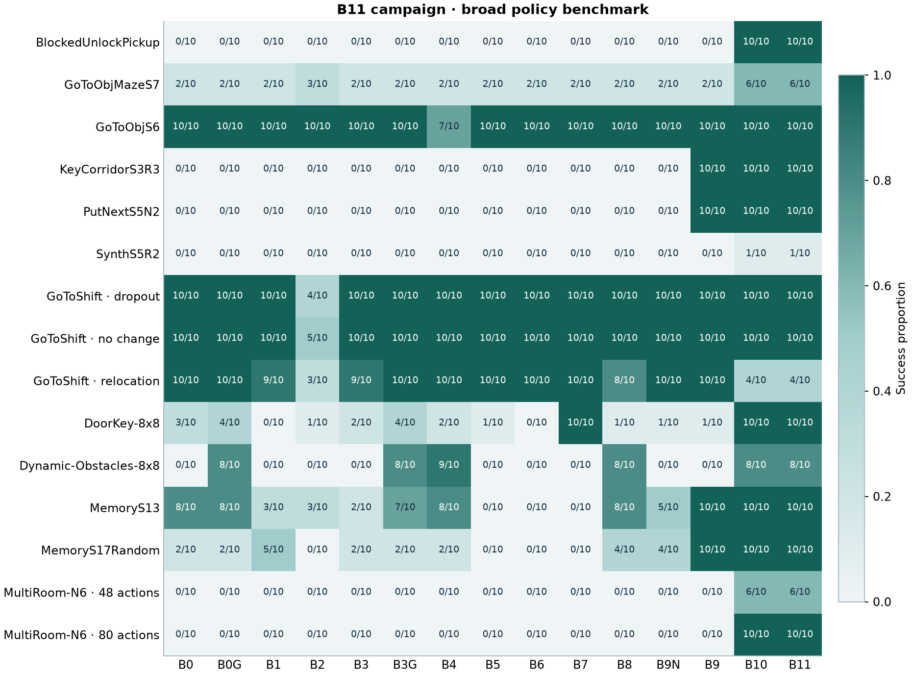](docs/visualizations.md#b11-broad-benchmark)

*Broad B11 benchmark. Each cell shows successes out of ten matched seeds. The gallery includes paired effects, mechanism results, inference cost, trajectories, and archive coverage.* [Research visualizations](docs/visualizations.md)

[B11 protocol](experiments/manifests/b11-protocol.md) · [Combined report](outputs/b11-combined-20261116-181345/report/report.md) · [Paired comparisons](outputs/b11-combined-20261116-181345/report/comparisons.csv)

## Architecture

The policy sees the mission and a local symbolic observation. Memory variants use observable action outcomes and odometry to track evidence across decisions. The model can propose an action or, in later variants, a goal. B11C supplies a fixed explore proposal to the same executor. The controller can route, verify or interact using the observed map. The resulting observation starts the next decision. A separate evaluator records the full board and intervention events.

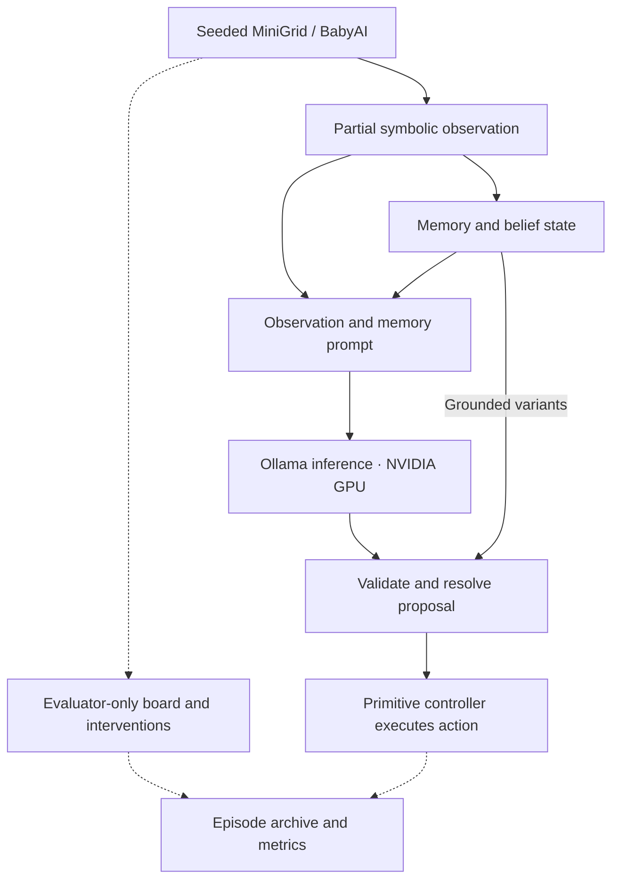

| Research role | Variants |
| --- | --- |
| Original memory comparison | **B0** reactive, **B1** bounded text history, **B2** passive structured evidence, **B3** structured memory with explicit revision. |
| Retrieval and grounded planning | **B4** subgoal retrieval, **B5** observed-map planning, **B6** trace-derived DoorKey routine, **B7** handwritten routine. |
| Task memory and deterministic control | **B8** hallway cue, **B9** verified subgoals and interaction state, **B10** mission roles, exploration and preconditions. |
| Mechanism controls | **B11** revising semantic memory and adaptive verification, with text, passive, fixed-verification and controller-only arms. |

[Architecture and ablations](docs/architecture.md) · [Agent implementation](src/embodiedmind/agents)

## Experimental environments

The 11 stock tasks cover object search, mazes, doors and keys, hallway cue recall, object placement, room navigation, and moving obstacles. The custom **GoToShift** task isolates information loss and hidden target relocation by pairing layouts across no-change, dropout and relocation conditions.

The stock examples use B11 on seed 11001. GoToShift shows B11R under hidden relocation on seed 11101. Each archived final evaluator frame links to the episode replay.

| GoToObjS6 | GoToObj Maze | GoToShift |
| --- | --- | --- |
| [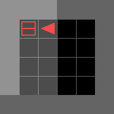](outputs/b11-stock-20261116-181345/episodes/e00-s11001-none-B11-r0/replay.gif) | [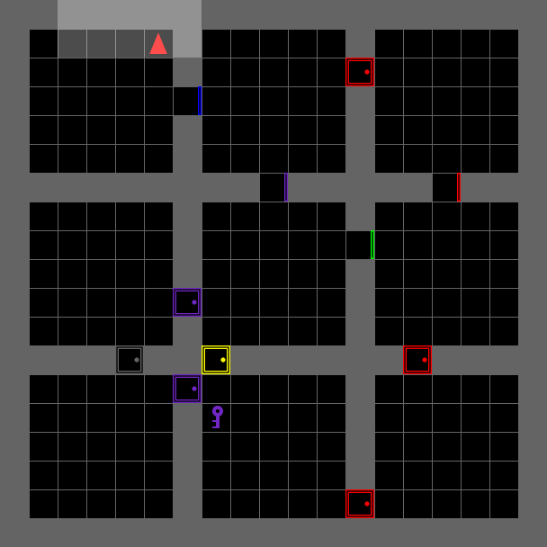](outputs/b11-stock-20261116-181345/episodes/e02-s11001-none-B11-r0/replay.gif) | [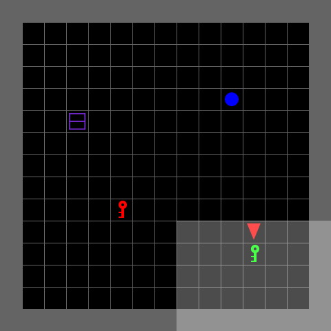](outputs/b11-rq-shift-20261116-181345/episodes/e00-s11101-relocation-B11R-r0/replay.gif) |
| Success · 6 actions | Budget reached · 48 actions | Success · 13 actions |

| DoorKey | KeyCorridor | BlockedUnlockPickup |
| --- | --- | --- |
| [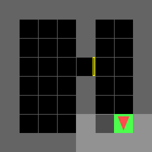](outputs/b11-stock-20261116-181345/episodes/e01-s11001-none-B11-r0/replay.gif) | [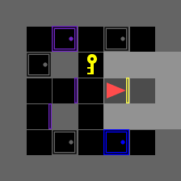](outputs/b11-stock-20261116-181345/episodes/e06-s11001-none-B11-r0/replay.gif) | [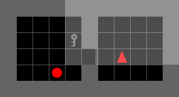](outputs/b11-stock-20261116-181345/episodes/e07-s11001-none-B11-r0/replay.gif) |
| Success · 15 actions | Success · 24 actions | Success · 24 actions |

| MemoryS13 | MemoryS17 Random | MultiRoom N6 |
| --- | --- | --- |
| [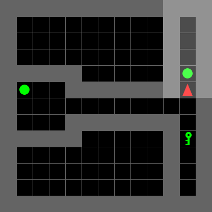](outputs/b11-stock-20261116-181345/episodes/e03-s11001-none-B11-r0/replay.gif) | [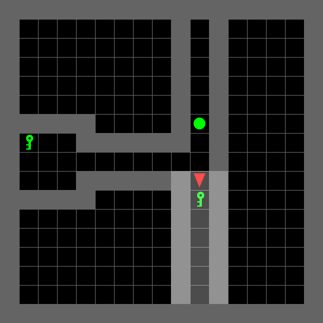](outputs/b11-stock-20261116-181345/episodes/e04-s11001-none-B11-r0/replay.gif) | [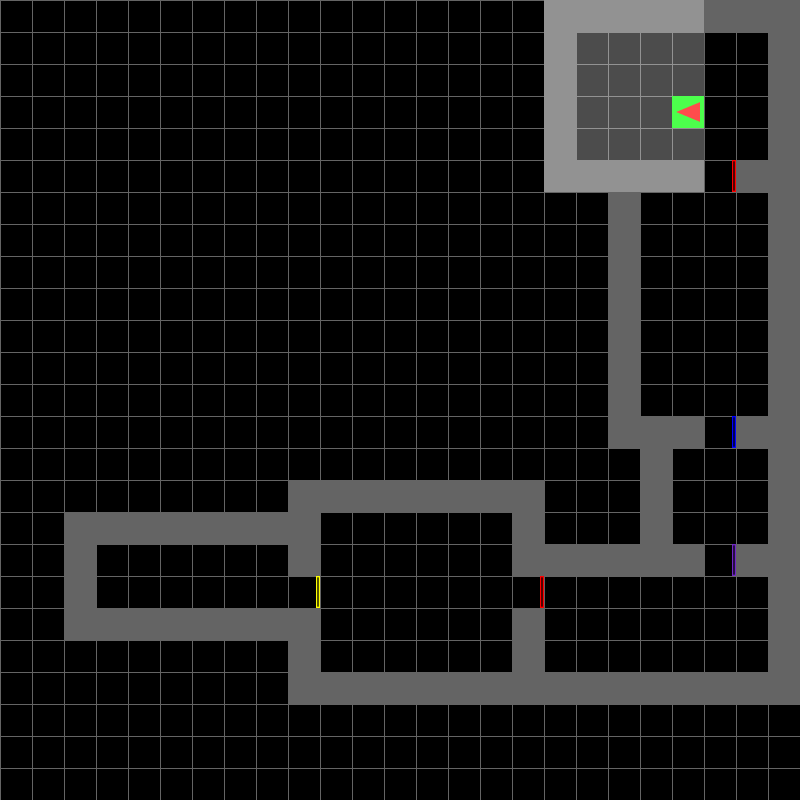](outputs/b11-stock-20261116-181345/episodes/e05-s11001-none-B11-r0/replay.gif) |
| Success · 11 actions | Success · 11 actions | Success · 44 actions |

| PutNext | Synth | Dynamic Obstacles |
| --- | --- | --- |
| [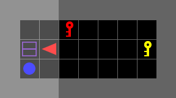](outputs/b11-stock-20261116-181345/episodes/e08-s11001-none-B11-r0/replay.gif) | [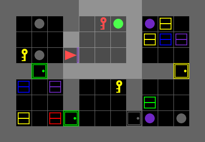](outputs/b11-stock-20261116-181345/episodes/e10-s11001-none-B11-r0/replay.gif) | [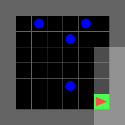](outputs/b11-stock-20261116-181345/episodes/e09-s11001-none-B11-r0/replay.gif) |
| Success · 21 actions | Budget reached · 48 actions | Success · 14 actions |

[GoToShift B11P replay](outputs/b11-rq-shift-20261116-181345/episodes/e00-s11101-relocation-B11P-r0/replay.gif) · [Paired relocation trajectories](docs/visualizations.md#relocation-trajectory)

## Experiment viewer

[](docs/viewer.md)

- **Replay** reconstructs saved episodes and compares policies side by side. The evaluator board and the agent’s partial view are shown separately. Inspect the observation, model input, retrieved facts, proposed action and executed action at each step.
- **Live monitor** follows archived snapshots from runs started with `--monitor`.
- **Sandbox** starts a seeded environment or branches before a saved action. Manual controls work offline. Agent moves and auto-play use local Ollama when the selected policy is model-backed.

[Viewer walkthrough](docs/viewer.md)

## Quick start

### NVIDIA GPU Setup

The development system uses a **GeForce RTX 5070 Ti Laptop GPU with 12 GB VRAM**, Windows 11 and Ubuntu 22.04.5 LTS under WSL2. CUDA-backed inference runs in Ollama. Python handles environment simulation, policy orchestration and analysis.

On native Linux, install a CUDA-capable NVIDIA driver compatible with your GPU and Ollama. On WSL2, install the NVIDIA driver on Windows and run Ollama inside Ubuntu with the host-provided CUDA interface. Run `nvidia-smi` in the Linux shell that will host Ollama. See the [Ollama hardware guide](https://docs.ollama.com/gpu), [NVIDIA WSL guide](https://docs.nvidia.com/cuda/wsl-user-guide/) and [GPU troubleshooting](docs/reproducibility.md#gpu-troubleshooting).

**1. Install the locked Python environment** from the repository root in Ubuntu.

```sh
uv sync --locked --inexact
```

**2. Start Ollama and verify GPU placement.** Use the existing local Ollama service if it is serving on port 11434 with one inference slot. To start Ollama in a shell, run:

```sh
OLLAMA_HOST=127.0.0.1:11434 OLLAMA_NUM_PARALLEL=1 OLLAMA_MAX_LOADED_MODELS=1 ollama serve
```

In another shell, pull the tag if needed, warm the configured model at the experiment context size and check residency.

```sh
export OLLAMA_HOST=http://127.0.0.1:11434
ollama list
ollama show qwen2.5:3b-instruct >/dev/null 2>&1 || ollama pull qwen2.5:3b-instruct
curl --fail --silent --show-error http://127.0.0.1:11434/api/generate \
  --header 'Content-Type: application/json' --data '{"model":"qwen2.5:3b-instruct","prompt":"Reply READY","stream":false,"options":{"num_ctx":4096,"num_predict":8}}'
ollama ps
```

Expect `100% GPU` in the processor column. The runner checks the full digest and `Q4_K_M` quantization in [models.yaml](configs/models.yaml). Heavier models or larger contexts can exceed 12 GB VRAM.

**3. Run one GPU-backed smoke episode.** The smoke config uses B0 on BabyAI GoToObj at seed 42, with at most 24 actions and 24 model calls.

```sh
unset BABYAI_DONE_ACTIONS
run="outputs/gpu-smoke-$(date +%Y%m%d-%H%M%S)"
.venv/bin/embodiedmind run --config configs/smoke.yaml --output "$run" --monitor --parallel 1
.venv/bin/embodiedmind status "$run"
```

**4. Run lightweight tests and use saved evidence offline.** These commands work without Ollama or a GPU. `report` writes derived output to the path supplied.

```sh
.venv/bin/python -m pytest -q
.venv/bin/embodiedmind smoke --env BabyAI-GoToObjS6-v1 --seed 42
.venv/bin/embodiedmind report outputs/b11-rq-shift-20261116-181345 \
  --output "${TMPDIR:-/tmp}/embodiedmind-shift-report"
```

**5. Launch the viewer** and open [localhost:8765](http://127.0.0.1:8765).

```sh
.venv/bin/embodiedmind viewer
```

## Reproducibility

**From saved artifacts.** Replay episodes or regenerate metrics and figures from the archived trajectories. The B11 archives include manifests, rosters, per-attempt data, evaluator records and SHA-256 indexes. The original study’s raw bundle remains in its local study directory.

**From model-backed execution.** Use the source revision and settings in the run manifest, the locked Python environment, matched seeds and intervention schedules, pinned model digest and one active inference slot. The original held-out runner also checks the calibrated runtime profile and full GPU residency.

[Reproduction commands and archive layout](docs/reproducibility.md) · [Study status and evidence](STATUS.md)

## Research status and open questions

The original held-out study and the B11 follow-up are complete. Open questions include when revision generalizes beyond GoToShift, when active verification changes decisions, and which tasks benefit from model reasoning given a strong deterministic controller. The current evidence comes from discrete symbolic simulation. PyBullet and physical robotics are possible future extensions. [Research proposal](RESEARCH_PROPOSAL.md) · [Current status](STATUS.md)

## References and citation

- Chevalier-Boisvert et al. (2019), [BabyAI: A Platform to Study the Sample Efficiency of Grounded Language Learning](https://arxiv.org/abs/1810.08272).
- Chevalier-Boisvert et al. (2023), [MiniGrid & MiniWorld: Modular & Customizable Reinforcement Learning Environments for Goal-Oriented Tasks](https://proceedings.neurips.cc/paper_files/paper/2023/hash/e8916198466e8ef218a2185a491b49fa-Abstract.html) and the [MiniGrid source](https://github.com/Farama-Foundation/Minigrid).
- Yao et al. (2023), [ReAct: Synergizing Reasoning and Acting in Language Models](https://arxiv.org/abs/2210.03629).

### Max Planck and Tübingen related work

The research proposal discusses these papers in the context of the CaCTüS research topics. [Proposal and literature review](RESEARCH_PROPOSAL.md#e-related-literature-and-verified-researcher-connections)

- Sancaktar et al. (ICML 2025) use vision-language model feedback to guide exploration in model-based reinforcement learning. [SENSEI: Semantic Exploration Guided by Foundation Models to Learn Versatile World Models](https://proceedings.mlr.press/v267/sancaktar25a.html).
- Wang, Kaufmann, and Dayan (PLOS Computational Biology, 2026) model human response inhibition as a partially observable decision process. [Decomposing response inhibition: A POMDP model](https://journals.plos.org/ploscompbiol/article?id=10.1371%2Fjournal.pcbi.1014068).
- Geiping et al. (NeurIPS 2025) scale test-time computation by repeating a block within a language model. [Scaling up Test-Time Compute with Latent Reasoning: A Recurrent Depth Approach](https://proceedings.neurips.cc/paper_files/paper/2025/hash/3b01972cf31e6fa0fe29e4b8b5c2a0a1-Abstract-Conference.html).

### Citing EmbodiedMind

When citing EmbodiedMind, cite the [repository](https://github.com/adithya-a-labs/embodiedmind) at the Git commit you used. For experimental results, include the registered protocol and run ID.
