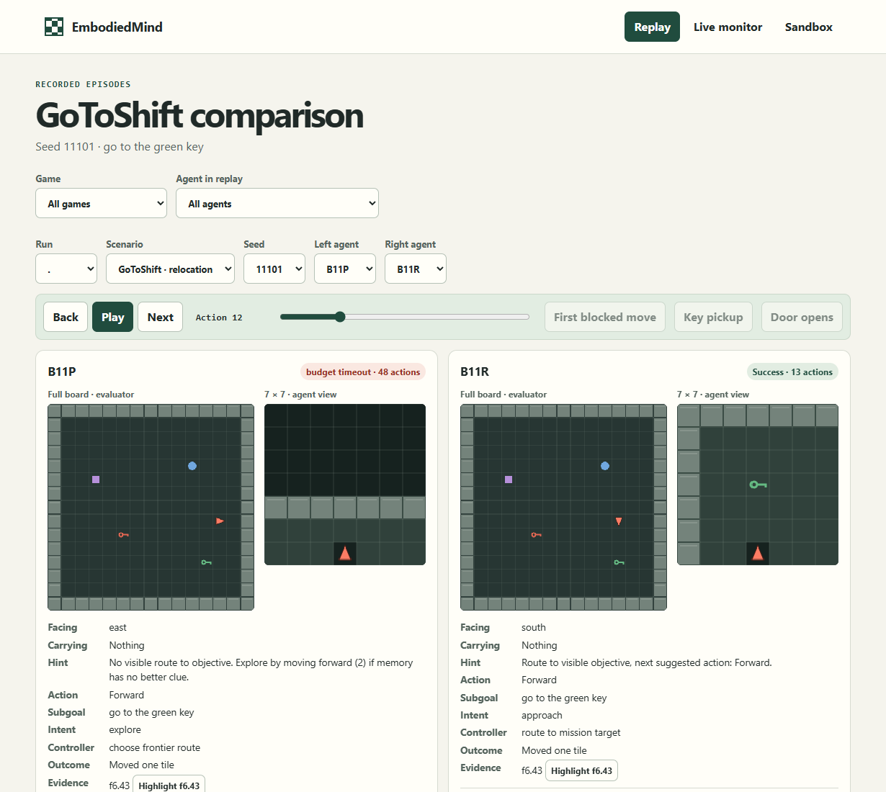

# Experiment viewer

From the Linux checkout, run `.venv/bin/embodiedmind viewer` and open [localhost:8765](http://127.0.0.1:8765). The viewer discovers `outputs/` and `results/runs/`. To open a specific archive, pass its directory.

```sh
.venv/bin/embodiedmind viewer --runs outputs/b11-rq-shift-20261116-181345
```

## Compare agents in Replay



*GoToShift seed 11101, before action 12. B11R has the relocated green key in view.*

1. In **Replay**, choose GoToShift and the B11 mechanism archive. The run is shown as `.` when the viewer opens that archive directly. Select seed **11101** with **relocation**.
2. Compare **B11P** (passive) with **B11R** (revising). Both see the moved green key at step 6. B11R reaches it in 13 actions. B11P exhausts the 48-action budget.
3. Scrub the timeline. Read the evaluator board alongside the agent’s symbolic view. Open **Model input and memory** and select a fact to locate it on the board. The action inspector shows the proposed and executed actions and the observed outcome.

Replay reconstructs observations and outcomes from saved actions and checks them against the trace. It works without Ollama. [B11P episode](../outputs/b11-rq-shift-20261116-181345/episodes/e00-s11101-relocation-B11P-r0) · [B11R episode](../outputs/b11-rq-shift-20261116-181345/episodes/e00-s11101-relocation-B11R-r0)

## Follow a live run

Start the viewer with its default archive discovery. In another shell, run the [monitored smoke example](../README.md#quick-start) or resume an existing run with `--monitor`. **Live monitor** follows the active run automatically. Selecting a run pins it. **Follow active run** restores automatic selection. The runner continues when the browser closes.

## Explore in Sandbox

Start a new seeded environment or select **Take over before action** from a replay. Use the buttons or arrow keys for manual control. **Agent move** and **Auto-play** use local Ollama for model-backed policies. Saving a session writes a separate archive under `outputs/sandbox-…/`; you can open it in Replay.

For access from another device, the viewer supports an authenticated, private Microsoft Dev Tunnel forwarding the viewer port. Pass the exact forwarded origin to `viewer --tunnel-origin HTTPS_ORIGIN`. Keep the Ollama endpoint on loopback.

[Back to documentation](README.md)
