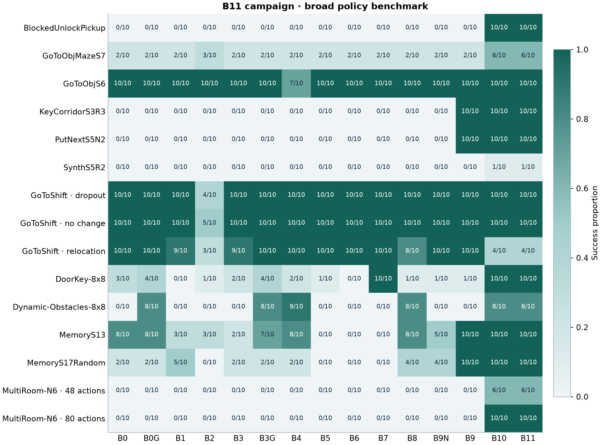
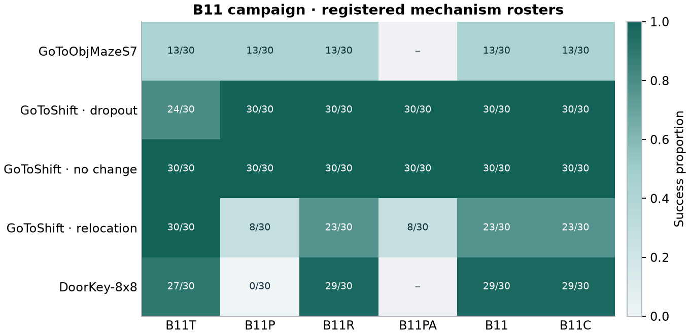
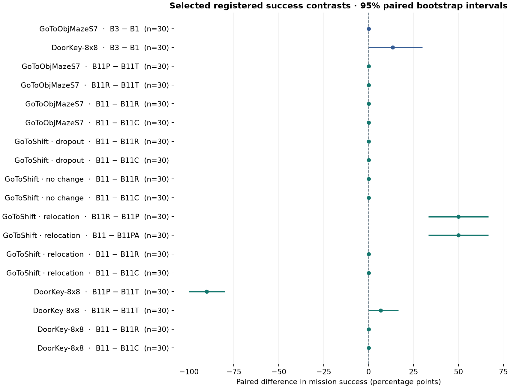
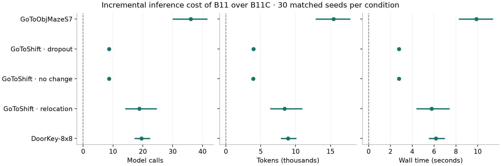
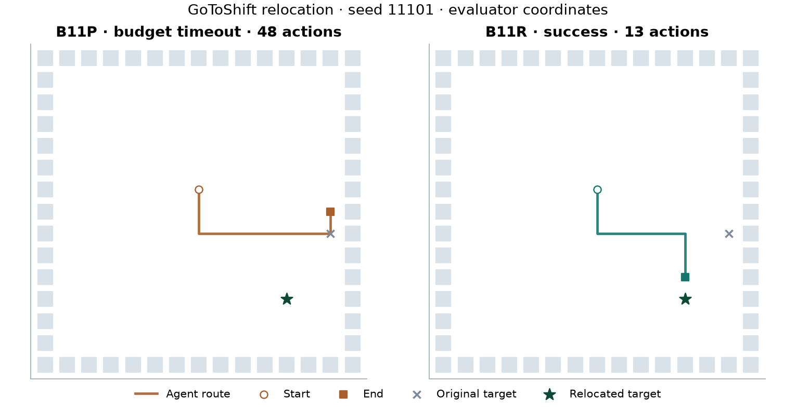
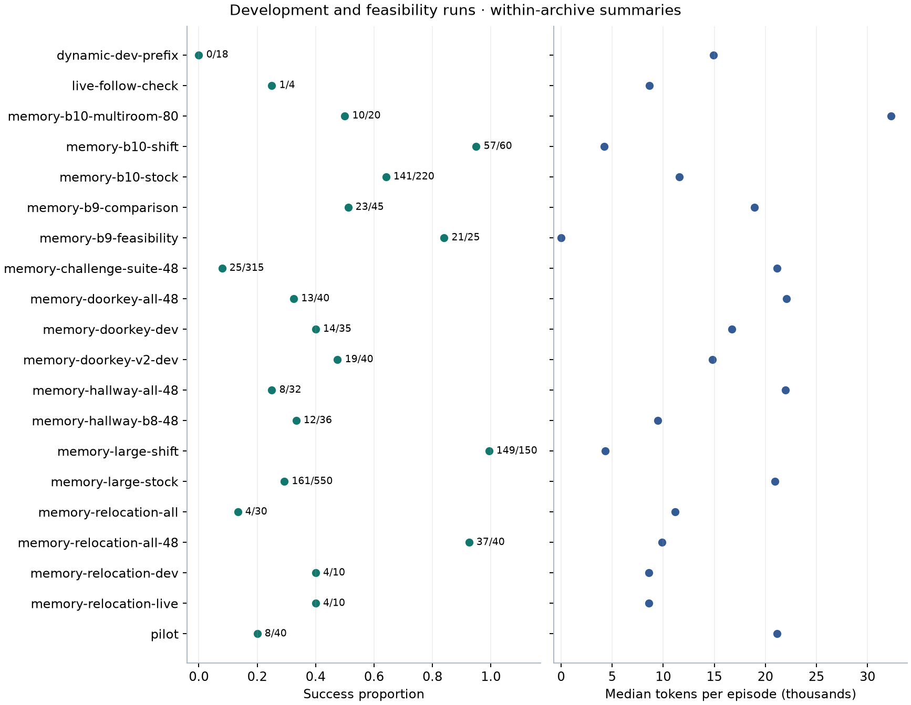
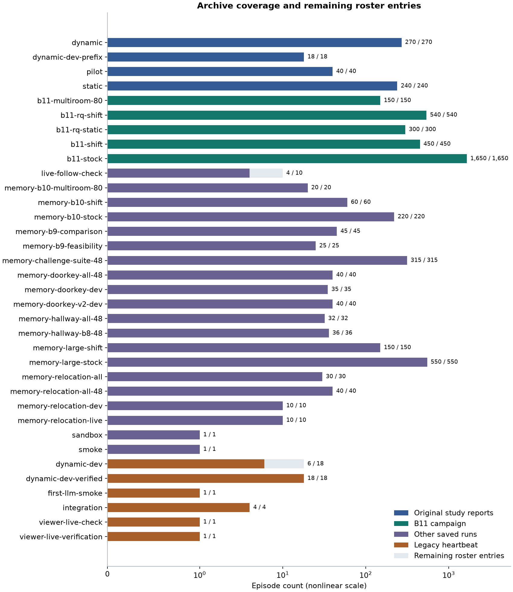

# Research visualizations

The Matplotlib gallery reads saved reports and a pair of evaluator traces. Each figure preserves the run or registered contrast used to make it. Descriptive development summaries can include repeated seeds, different policy sets and different action budgets.

## B11 broad benchmark

[](figures/b11-benchmark.png)

Each cell shows successful missions over valid episodes. The 15 cases and 15 policies account for **2,250 episodes**, including 150 episodes in the separate 80-action MultiRoom roster. This view compares complete policies on 10 seeds per cell. [Broad protocol](../experiments/manifests/b11-protocol.md) · [Episode metrics](../outputs/b11-combined-20261116-181345/report/metrics.csv)

## B11 mechanism rosters

[](figures/b11-mechanisms.png)

The two mechanism rosters contribute **840 episodes**, with 30 seeds per scheduled case and arm. A dash marks an unscheduled arm. GoToShift dropout, no change, and relocation are separate assignments. [Mechanism protocol](../experiments/manifests/b11-protocol.md#mechanism-conditions) · [Earlier GoToShift figure](../outputs/b11-rq-shift-20261116-181345/report/figures/success.png)

## Paired success differences

[](figures/paired-success.png)

Dots show the change in success for the first policy relative to the second. Lines show the archived 95% paired bootstrap intervals in percentage points. Blue marks the original B3–B1 held-out comparisons. Green marks selected B11 contrasts covering representation, revision, verification and model use. An interval with identical endpoints appears as a dot. [Original results](../reports/technical_report.md) · [B11 paired estimates](../outputs/b11-combined-20261116-181345/report/comparisons.csv)

## Controller-only inference cost

[](figures/controller-cost.png)

Each panel shows the archived paired mean difference for B11 minus B11C, with a 95% paired bootstrap interval. Wall time measures the full episode on the recorded system. Both arms produced the same action sequences in all 150 registered pairs. B11C made zero model calls. The comparison applies to these five cases and their shared executor. [B11 combined report](../outputs/b11-combined-20261116-181345/report/report.md)

## Relocation trajectory

[](figures/relocation-trajectories.png)

The two paths use evaluator positions from the same GoToShift seed. Turns and repeated visits overlap in this spatial view. The wall outline and original and relocated target markers come from archived evaluator state, which is kept separate from policy inputs. This is one example from the registered roster. [B11P replay](../outputs/b11-rq-shift-20261116-181345/episodes/e00-s11101-relocation-B11P-r0/replay.gif) · [B11R replay](../outputs/b11-rq-shift-20261116-181345/episodes/e00-s11101-relocation-B11R-r0/replay.gif)

## Development and feasibility runs

[](figures/development-runs.png)

The two panels show within-run success and median prompt-plus-completion tokens across **1,720 valid development and feasibility episodes** with normalized metrics. Valid task failures stay in the denominator. The token median uses rows with recorded token totals, including recorded zeroes. Differences in tasks, action caps and policy mixes make these summaries unsuitable as a policy ranking. [Development report](../reports/memory-48-development-20261114/README.md) · [B9 audit](../reports/b9-failure-analysis-20261114/README.md)

## Archive coverage

[](figures/run-coverage.png)

The chart covers **35 archives**, including incomplete runs, smoke tests and an interactive sandbox. The colored bars show valid rows from normalized reports or completed episodes from the older supervisor heartbeats. The grey endpoint shows the planned roster. Six older runs have heartbeat coverage here. The archived tables used in the performance plots supply no normalized episode metrics for those six. Combined and regenerated reports refer to already counted episodes. [Study status and archive locations](../STATUS.md)

## Data and regeneration

| Input | Fields used |
| --- | --- |
| B11 combined `metrics.csv` | Run and job IDs, split, task, assigned intervention, policy, validity and mission success. |
| B11 combined and original held-out `comparisons.csv` | Named treatment and control, task and intervention, matched count, paired differences and stored interval bounds. |
| Individual `outputs/*/report/metrics.csv` and local original final/pilot tables | Archive identity, episode status, success and token totals. The original pilot entries appearing in both tables are counted once. |
| Legacy `results/runs/` heartbeats | Completed and planned counts for archives without normalized episode metrics in the supplied reports. |
| B11P and B11R seed 11101 evaluator traces and episode summaries | Grid size, wall coordinates, agent positions by step, intervention target coordinates, outcome and action count. |

The plotting script uses saved observations through the report tables and selected replay records. It reads existing counts and bootstrap intervals, aggregates per-case success, and renders PNGs with Matplotlib’s headless Agg backend. It requires no model inference. Run it with the locked Python environment from the repository root:

```sh
.venv/bin/python scripts/render_research_figures.py --legacy-runs results/runs --output /tmp/embodiedmind-figures
```

The complete gallery uses the original local study and viewer-check archives under `results/runs/`. Omit `--legacy-runs` to render from the tracked `outputs/` archives alone. The coverage and development figures will cover fewer runs, and the paired-success figure will omit the original-study contrasts. [Plotting script](../scripts/render_research_figures.py) · [Reproduction guide](reproducibility.md)
